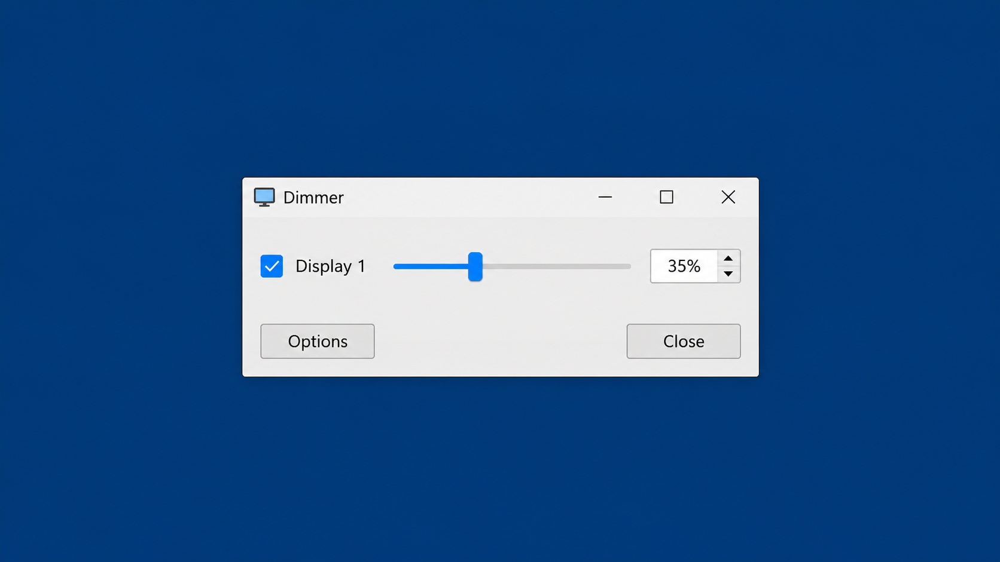
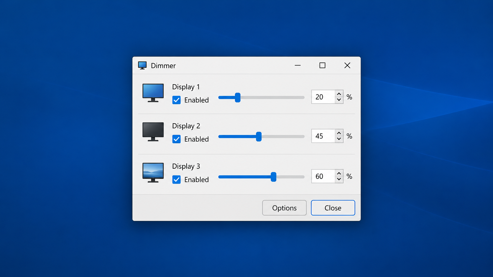
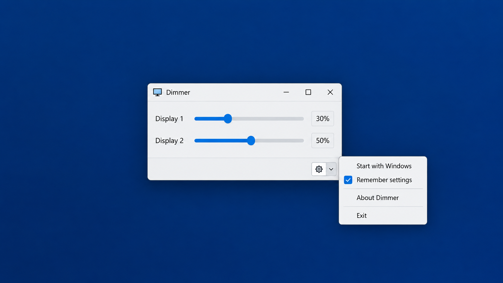

# Dimmer Light Switch Buying Guide - Practical Hardware Selection And Embedded Lighting Control Reference

## Description

Dimmer Light is an open-source reference for evaluating a dimmer light switch and implementing phase-controlled lighting with supported microcontrollers. The Dimmer Light organization maintains the Dimmer Light Switch Buying Guide repository as both a buying guide and a practical C/C++ codebase for dimmable lighting experiments.

The guide covers a dimmer switch, led dimmer switch, smart dimmer switch, plug in dimmer, slide dimmer switch, rocker dimmer switch, remote dimmer switch, double dimmer switch, and push button dimmer switch. It also connects purchasing decisions to real implementation concerns such as dimmer switch wattage, bulb compatibility, zero-cross detection, timer behavior, output channels, buttons, encoders, relays, and PWM lighting control.



### What is a dimmer light?

A dimmer light is a lighting system whose brightness can be adjusted instead of being limited to fully on or fully off. The system normally combines dimmable light bulbs with a compatible dimmer light switch that regulates the power delivered to the load.

For mains-powered lamps, the control method may use phase-cut switching synchronized with the AC zero crossing. The Dimmer Light implementation provides architecture-specific timer and controller code for this purpose. For low-voltage lighting, a led dimmer switch may instead use PWM or a dedicated LED driver.

Dimmer Light Switch Buying Guide distinguishes the lamp, driver, control interface, and wiring arrangement because each affects compatibility. A dimmer switch for led lights must be compatible with the electrical design of the dimmable led light bulbs, not merely with their stated wattage.

## Lighting Control Vocabulary

dimmer light, dimmer light switch, dimmer light switch buying guide, best dimmer switch for led lights, how to choose a dimmer switch for led lights, dimmer switch, led dimmer switch, smart dimmer switch, bulb-compatibility, electrical-wiring, smart-lighting, lighting-control, home-automation

## Features

- Supports practical comparison of the main types of dimmer switches.
- Covers single pole dimmer switch and 3 way dimmer switch installations.
- Explains led bulb and dimmer compatibility.
- Includes examples for one light, multiple lights, linearized brightness, automatic frequency selection, buttons, potentiometers, and serial control.
- Provides implementations for AVR, ESP32, ESP8266, SAM, SAMD21, STM32F1, and Raspberry Pi Pico timer environments.
- Includes ESPurna modules for buttons, rotary encoders, GPIO, LEDs, lights, PWM, and relays.
- Supports configurable light management and multiple dimmer channels.
- Includes build workflows, unit tests, formatting configuration, and PlatformIO metadata.

[](https://dimmer-light.github.io/dimmer-light-switch/dimmer-light)

## Hardware

The correct dimmer light hardware depends on the load, wiring, control method, and microcontroller. A mains dimmer normally requires a suitable zero-cross detector, an isolated control stage, and a correctly rated switching device such as a triac or thyristor. Low-voltage LEDs may require PWM hardware instead.

The implementation entry points are available in:

- [`src/RBDdimmer.h`](src/RBDdimmer.h) for the dimmer interface.
- [`src/thyristor.h`](src/thyristor.h) for thyristor control.
- [`src/dimmable_light.h`](src/dimmable_light.h) for a dimmable light.
- [`src/dimmable_light_manager.h`](src/dimmable_light_manager.h) for multiple lights.
- [`src/dimmable_light_linearized.h`](src/dimmable_light_linearized.h) for linearized brightness.
- [`code/espurna/light.h`](code/espurna/light.h) and [`code/espurna/pwm.h`](code/espurna/pwm.h) for ESPurna lighting and PWM integration.



### Dimmer Switch Selection

| Requirement | Suitable Category | Main Check |
|---|---|---|
| One switch controls one circuit | Single pole dimmer switch | Load type, minimum load, maximum wattage, and neutral requirements |
| Two locations control one circuit | 3 way dimmer switch | Companion-switch and traveler-wire compatibility |
| LED lamps | Led compatible dimmer switch | Approved dimmable led light bulbs and stable low-load operation |
| Connected control | Smart dimmer switch | Neutral wire, wireless system, standby power, and manual fallback |
| No neutral conductor | Smart dimmer switch no neutral | Minimum load and bypass requirements |
| Portable lamp | Plug in lamp dimmer | Plug type, lamp wattage, and bulb compatibility |
| Familiar wall control | Slide dimmer switch or rocker dimmer switch | Physical dimensions and preferred adjustment style |
| Separate loads | Double dimmer switch | Independent channel ratings and available box space |
| Wireless operation | Remote dimmer switch | Pairing method, range, and local control |
| Momentary control | Push button dimmer switch | Supported press, hold, and recall behavior |

### Do I need an electrician to change a dimmer switch?

Installing a dimmer switch involves mains voltage and can cause electrocution, fire, or equipment damage when performed incorrectly. A licensed electrician should perform the work whenever local regulations require one or when the circuit, grounding, neutral conductor, load type, or existing wiring is uncertain.

Replacing a single pole dimmer switch may appear straightforward, but wire colors alone do not reliably identify line, load, neutral, ground, and traveler conductors. Installing a 3 way dimmer switch is more complex because the selected dimmer and its companion controls must support the existing topology.

The embedded examples in Dimmer Light Switch Buying Guide demonstrate control software; they are not a substitute for isolation, fusing, enclosures, certified hardware, or qualified electrical work. Never program, probe, or modify a mains-connected controller while it is energized.

## Installation

Dimmer Light can be built as the standalone dimmable-light library or through the included ESPurna environment.

For PlatformIO, begin with [`platformio.ini`](platformio.ini) for the library examples or [`code/platformio.ini`](code/platformio.ini) for ESPurna. The project metadata is defined in [`library.json`](library.json), [`library.properties`](library.properties), [`library2.json`](library2.json), and [`library2.properties`](library2.properties).

For CMake-based builds, use [`CMakeLists.txt`](CMakeLists.txt). Unit-test configuration is available in [`code/test/unit/CMakeLists.txt`](code/test/unit/CMakeLists.txt).

The core header is included as follows:

```cpp
#include <RBDdimmer.h>
```

Board-specific implementations are selected from the architecture directories under `src`. Pin assignments and electrical capabilities must be checked against the target board before connecting control hardware.

## Usage

Start with the smallest example that matches the intended control:

- [`examples/1_dimmable_light/1_dimmable_light.ino`](examples/1_dimmable_light/1_dimmable_light.ino) controls one dimmer light.
- [`examples/2_dimmable_lights/2_dimmable_lights.ino`](examples/2_dimmable_lights/2_dimmable_lights.ino) demonstrates two channels.
- [`examples/3_dimmable_light_5_light/3_dimmable_light_5_light.ino`](examples/3_dimmable_light_5_light/3_dimmable_light_5_light.ino) expands the arrangement to five lights.
- [`examples/4_lights_manager/4_lights_manager.ino`](examples/4_lights_manager/4_lights_manager.ino) uses the light manager.
- [`examples/5_dimmable_manager_n_lights/5_dimmable_manager_n_lights.ino`](examples/5_dimmable_manager_n_lights/5_dimmable_manager_n_lights.ino) manages a configurable number of lights.
- [`examples/6_8_lights_effects/6_8_lights_effects.ino`](examples/6_8_lights_effects/6_8_lights_effects.ino) demonstrates eight lights and effects.
- [`examples/7_linearized_dimmable_light/7_linearized_dimmable_light.ino`](examples/7_linearized_dimmable_light/7_linearized_dimmable_light.ino) applies linearized dimming.
- [`examples/8_set_frequency_automatically/8_set_frequency_automatically.ino`](examples/8_set_frequency_automatically/8_set_frequency_automatically.ino) demonstrates automatic frequency selection.

Additional input examples include:

- [`examples/SerialMonitorDim/SerialMonitorDim.ino`](examples/SerialMonitorDim/SerialMonitorDim.ino)
- [`examples/SimpleButton/SimpleButton.ino`](examples/SimpleButton/SimpleButton.ino)
- [`examples/SimplePotentiometer/SimplePotentiometer.ino`](examples/SimplePotentiometer/SimplePotentiometer.ino)
- [`examples/SimpleToggleDimmer/SimpleToggleDimmer.ino`](examples/SimpleToggleDimmer/SimpleToggleDimmer.ino)
- [`examples/TwoButtonsFluently/TwoButtonsFluently.ino`](examples/TwoButtonsFluently/TwoButtonsFluently.ino)

### Is there a way to make LED lights dimmer?

Yes. The preferred method is to use dimmable led light bulbs with an led compatible dimmer switch. The dimmer and bulb must support the same control method and operating range.

For mains-powered LEDs, choose a dimmer switch for led lights that supports the bulb driver and remains stable at low load. For low-voltage strips or modules, use a correctly sized PWM driver or led dimmer switch rather than applying an AC phase-cut design directly.

Dimmer Light provides both phase-control and PWM-oriented source material. The phase-control implementation is centered on [`src/dimmable_light.cpp`](src/dimmable_light.cpp), while ESPurna PWM behavior is implemented in [`code/espurna/pwm.cpp`](code/espurna/pwm.cpp). Linearized control in [`src/dimmable_light_linearized.cpp`](src/dimmable_light_linearized.cpp) can make perceived brightness changes smoother because human brightness perception is not linear.

## Compatibility

The best dimmer switch for led lights is determined by verified compatibility, not solely by brand, appearance, or the sum of bulb wattages.

Check all of the following:

1. Confirm that every lamp is explicitly marked as dimmable.
2. Confirm that the dimmer supports LED loads.
3. Check the dimmer switch wattage rating for LED loads, which can differ from its incandescent rating.
4. Check the minimum load as well as the maximum load.
5. Confirm whether the circuit is single-pole or three-way.
6. Confirm whether a neutral wire is available.
7. Verify the number of lamps and their inrush behavior.
8. Check the supported dimming range for the exact bulb and dimmer combination.
9. Confirm that the enclosure, heat dissipation, and electrical box meet the installation requirements.



### Do you need dimmable light bulbs for a dimmer switch?

Yes. A conventional dimmer switch should be used with dimmable light bulbs. Standard non-dimmable LED bulbs can flicker, buzz, fail to reach a stable brightness, shut off unexpectedly, or suffer reduced service life when connected to a dimmer.

Light bulbs for dimmer switch use must also be compatible with the dimmer’s control method. The phrase “dimmable” alone does not guarantee that every dimmable bulb will operate correctly with every dimmer switch. Led bulb and dimmer compatibility should be checked for the exact models whenever possible.

The answer to how many led bulbs can a dimmer switch handle is not obtained by dividing only the dimmer’s incandescent wattage by the bulb wattage. Use the manufacturer’s LED load rating, minimum load, supported lamp count, and compatibility information.

### Product Comparison Entries

The Dimmer Light Switch Buying Guide uses the following product terms as comparison entries:

| Product Entry | Category To Verify |
|---|---|
| Lutron dimmer switch | Wiring topology, LED rating, and control style |
| Lutron Lumea dimmer | Slide control, load rating, and bulb compatibility |
| Lutron Skylark dimmer | Slide control, wall-box fit, and supported load |
| Lutron Caseta lamp dimmer | Plug in lamp dimmer, remote operation, and lamp compatibility |
| Lutron Lumea LECL-150H-WH | Exact LED load and installation specification |
| Lutron Skylark Contour CTCL-153PDH-WH | Exact bulb compatibility and wiring arrangement |
| Lutron Caseta lamp dimmer and remote kit | Plug-in load, remote pairing, and local control |

Model names alone are insufficient for selecting a dimmer light switch. Verify the current specification of the exact device and bulb combination before purchase or installation.

## Supported Platforms

Architecture-specific code is included for:

| Platform | Implementation |
|---|---|
| AVR | [`src/avr/RBDmcuAVR.cpp`](src/avr/RBDmcuAVR.cpp) |
| ESP32 | [`src/esp32/RBDmcuESP32.cpp`](src/esp32/RBDmcuESP32.cpp) |
| ESP8266 | [`src/esp8266/RBDmcuESP8266.cpp`](src/esp8266/RBDmcuESP8266.cpp) |
| SAM | [`src/sam/RBDmcuSAM.cpp`](src/sam/RBDmcuSAM.cpp) |
| SAMD21 | [`src/samd/RBDmcuSAMD21.cpp`](src/samd/RBDmcuSAMD21.cpp) |
| STM32F1 | [`src/stm32duino/STM32F1/RBDmcuSTM32F1.cpp`](src/stm32duino/STM32F1/RBDmcuSTM32F1.cpp) |
| Raspberry Pi Pico | [`src/hw_timer_pico.cpp`](src/hw_timer_pico.cpp) |

Hardware timer implementations are separated by architecture so that timing-sensitive dimmer light behavior does not depend on a generic blocking delay.

## Configuration

ESPurna defaults and hardware definitions are located in:

- [`code/espurna/config/defaults.h`](code/espurna/config/defaults.h)
- [`code/espurna/config/hardware.h`](code/espurna/config/hardware.h)
- [`code/test/build/config/light_dimmer.h`](code/test/build/config/light_dimmer.h)

Interactive controls are implemented through:

- [`code/espurna/button.cpp`](code/espurna/button.cpp)
- [`code/espurna/encoder.cpp`](code/espurna/encoder.cpp)
- [`code/espurna/gpio.cpp`](code/espurna/gpio.cpp)
- [`code/espurna/led.cpp`](code/espurna/led.cpp)
- [`code/espurna/relay.cpp`](code/espurna/relay.cpp)

A smart dimmer switch design should retain safe local control when networking is unavailable. Buttons and encoders should remain responsive while timing-sensitive light control continues independently.

## Troubleshooting

### Buzzing dimmer switch

A buzzing dimmer switch can indicate an incompatible bulb driver, unsuitable dimmer technology, excessive load, loose connection, or normal but objectionable electrical vibration. Disconnect power and have the installation inspected if the sound is new, loud, accompanied by heat, or associated with unstable lighting.

### Dimmer switch not dimming

A dimmer switch not dimming may be caused by non-dimmable bulbs, an unsupported LED driver, incorrect wiring, a load below the dimmer’s minimum, an incorrect three-way arrangement, or a failed device. Test only with known-compatible dimmable light bulbs and follow safe isolation procedures.

For the embedded implementation, also check the zero-cross input, output pin assignment, board timer selection, configured mains frequency, and whether the selected architecture is supported. The automatic-frequency example can help validate timing behavior.

### Flicker or poor low-end control

Flicker near minimum brightness often indicates led bulb and dimmer compatibility problems. Raise the minimum brightness, reduce mixed bulb types, and verify that the total load remains within the LED-specific range.

For software-controlled dimmer light hardware, avoid long blocking operations that disturb zero-cross timing. Use the architecture-specific timer implementation and begin with the single-light example before enabling multiple channels or effects.

## Testing

The repository includes unit-test targets for basic behavior, LED handling, and utilities:

- [`code/test/unit/src/basic/basic.cpp`](code/test/unit/src/basic/basic.cpp)
- [`code/test/unit/src/led/led.cpp`](code/test/unit/src/led/led.cpp)
- [`code/test/unit/src/utils/utils.cpp`](code/test/unit/src/utils/utils.cpp)

Automated builds are defined in [`build.yml`](.github/workflows/build.yml) and [`LibraryBuild.yml`](.github/workflows/LibraryBuild.yml). Local CI helpers are available in [`ci_install.sh`](ci_install.sh) and [`ci_script.sh`](ci_script.sh).

## Contributing

Contributions to Dimmer Light and Dimmer Light Switch Buying Guide should follow [`CONTRIBUTING.md`](CONTRIBUTING.md) and [`CODE_OF_CONDUCT.md`](CODE_OF_CONDUCT.md). Reports should identify the board, mains frequency, dimmer hardware, bulb model, load count, wiring topology, observed behavior, and a minimal reproducer.

Security concerns should follow [`SECURITY.md`](SECURITY.md). Changes to timing-sensitive code should include relevant tests and must not weaken electrical safety guidance.

## License

See [`LICENSE`](LICENSE).
